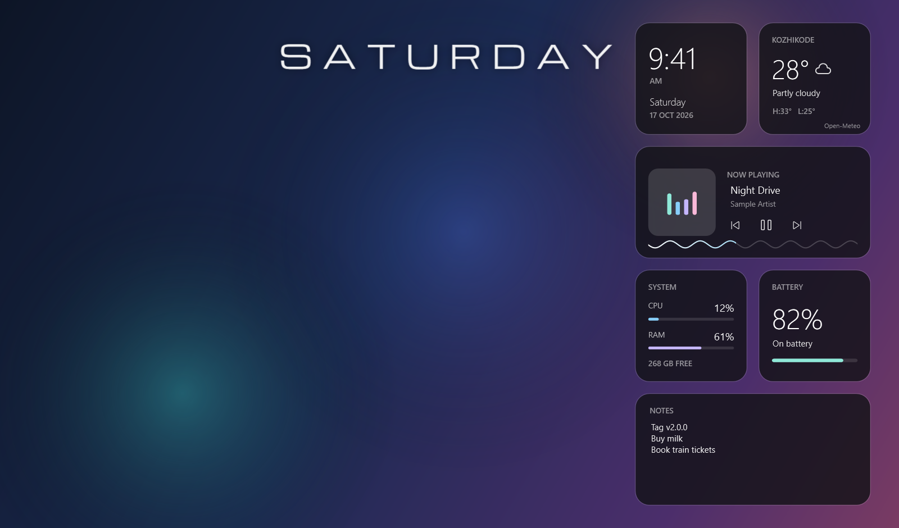
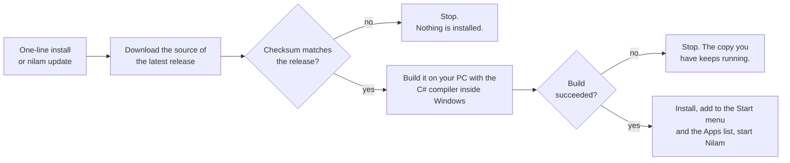
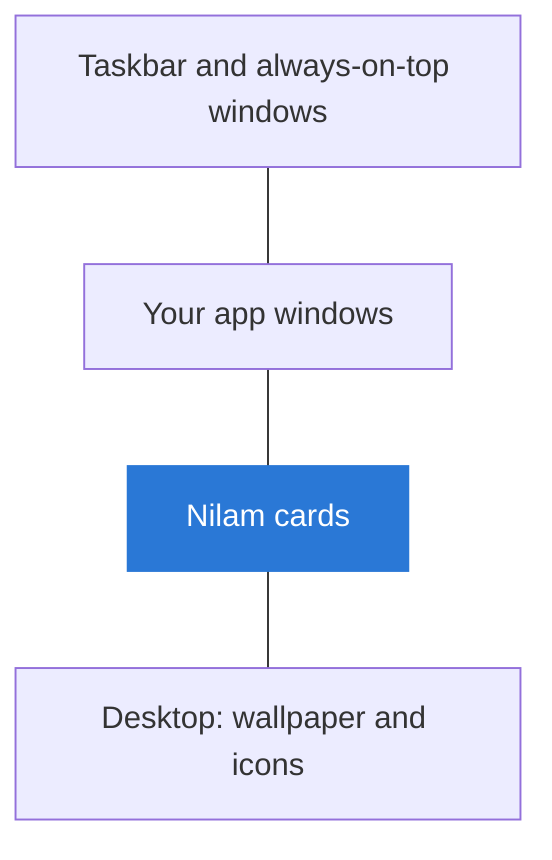
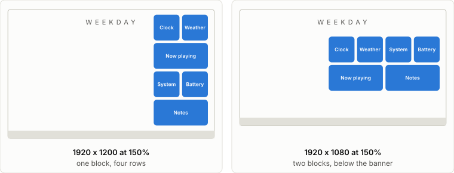
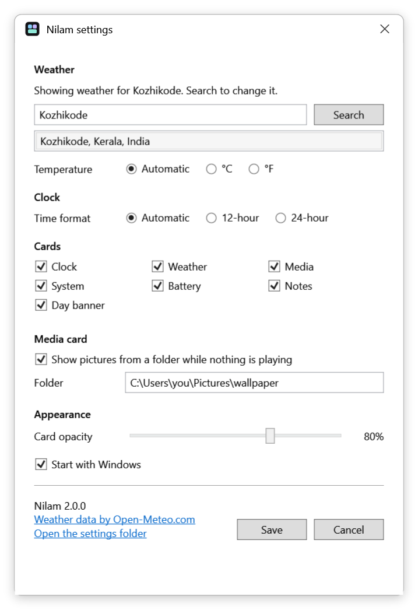
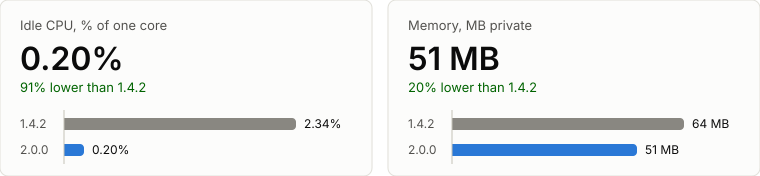

<h1 align="center">Nilam</h1>

<p align="center">
  <b>Desktop widgets for Windows.</b><br>
  Clock, weather, now playing, system stats, battery and notes, with a weekday banner -<br>
  sitting on your desktop, under every window.
</p>

<p align="center">
  <a href="https://github.com/jithin-jz/nilam/actions/workflows/ci.yml"></a>
  <a href="https://github.com/jithin-jz/nilam/releases/latest"></a>
  <a href="LICENSE"></a>
  
</p>

<p align="center">
  
</p>
<p align="center"><sub>
  Drawn from the app's own card markup with sample data, on a generated backdrop -
  <a href="tools/make-readme-images.ps1">see how</a>.
</sub></p>

> *Nilam* (നിലം) is Malayalam for the ground: the layer everything else stands
> on. That is where these widgets live. Every app window draws over them, so
> they are part of your desktop rather than something floating above your work.

---

## What you get

| Card | What it shows |
|---|---|
| **Clock** | The time in your own Windows format (12- or 24-hour), the day and the date |
| **Weather** | Temperature, conditions and today's high and low, for a city you pick by name |
| **Now playing** | Track, artist and cover art from any player that reports to Windows. Previous, play/pause and next control that player; drag the wave to seek |
| **System** | CPU, memory, and free space on the system drive |
| **Battery** | Charge, and whether it is charging, plugged in or on battery. Laptops only |
| **Notes** | A scratchpad that saves itself |
| **Day banner** | The weekday in large spaced capitals across the top of the screen |

- **Stays out of the way.** The cards never take focus, never appear in Alt+Tab,
  and sit behind every app window.
- **Yours to arrange.** Drag any card; positions snap to a grid and are
  remembered, on any monitor. Switch off the cards you don't want.
- **Small.** One exe, no background services, no runtime to install, no admin
  rights.
- **Private.** No account and no telemetry. [What leaves your machine](#your-data-and-privacy)
  fits in three rows.

---

## Install

In PowerShell:

```powershell
irm https://github.com/jithin-jz/nilam/releases/latest/download/install.ps1 | iex
```

Copy that **whole line** - it starts with `irm` and ends with `| iex`.

It needs **no admin rights**. This is what it does:



Installs come from **published releases**, never from the development branch,
and nothing you already have is touched until the new build has succeeded.

<details>
<summary><b>Other ways to install</b></summary>

**No typing.** Open the
[latest release](https://github.com/jithin-jz/nilam/releases/latest), download
`nilam-source.zip`, extract it anywhere and double-click **`install.cmd`**. If
Windows shows a "protected your PC" notice, choose **More info -> Run anyway**;
it appears for any script downloaded from the web.

**From a clone.**

```powershell
git clone https://github.com/jithin-jz/nilam.git
cd nilam
.\install.ps1
```

**Switches**, for either `install.ps1` or `install.cmd`:

| Switch | Effect |
|---|---|
| `-NoStartup` | do not start with Windows |
| `-NoLaunch` | install without starting the widgets |
| `-NoPath` | do not put the `nilam` command on `PATH` |
| `-InstallDir <path>` | install somewhere other than `%LOCALAPPDATA%\Nilam` |
| `-Ref <tag or branch>` | install a specific release, or a branch |
| `-SourcePath <path>` | install from a source folder or zip you already have |

</details>

**Requirements:** Windows 10 version 1809 or later, or Windows 11, with
.NET Framework 4.8 - which ships with Windows. There is no .NET SDK, NuGet,
Visual Studio or MSBuild dependency.

---

## Where the cards go

The cards live one layer above the wallpaper and below everything else:



By default they form a block at the right edge of the screen. On a screen too
short for all four rows, the rows split into two blocks instead of overlapping:

<p align="center">
  <picture>
    <source media="(prefers-color-scheme: dark)" srcset="docs/images/layout-dark.svg">
    
  </picture>
</p>

These positions are only the starting point - drag a card anywhere. A card you
put on a second monitor stays there; one left on a monitor you later unplug comes
back to its default spot.

---

## Settings

Right-click any card, or click the icon in the notification area.

<p align="center">
  
</p>

| | |
|---|---|
| **Weather** | search for your city by name; Celsius, Fahrenheit, or follow your region |
| **Clock** | 12-hour, 24-hour, or follow your Windows time format |
| **Cards** | switch any card off; the rest close up the gap |
| **Media card** | show pictures from a folder while nothing is playing, and which folder |
| **Appearance** | how opaque the cards are |
| **Startup** | start with Windows |

The same menu has **Lock positions**, so a stray drag cannot move anything,
**Reset positions**, and **Exit widgets**. To start again after exiting, find
*Nilam* in the Start menu.

---

## Light on your machine

<p align="center">
  <picture>
    <source media="(prefers-color-scheme: dark)" srcset="docs/images/perf-dark.svg">
    
  </picture>
</p>

| Idle, nothing playing | 1.4.2 | 2.0.0 |
|---|---|---|
| CPU, share of one core | 2.34% | 0.20% |
| Memory, private bytes | 64 MB | 51 MB |

Measured with both versions running side by side over the same eight seconds, on
one machine with a 1920x1200 display at 150%. Your numbers will differ; the
difference between the two is the point.

It stays this small on purpose: software rendering, a 32-bit build, plain Win32
calls instead of WMI, and no effect that has to be redrawn when nothing changed.
[docs/ARCHITECTURE.md](docs/ARCHITECTURE.md) has the reasoning and the
measurements behind each choice.

---

## Updating and uninstalling

```powershell
nilam version   # your installed version, and the latest release
nilam update    # install the latest release, if it is newer
nilam install   # reinstall the latest release regardless
```

To remove it, use **Settings > Apps > Installed apps > Nilam > Uninstall**, or
run `uninstall.ps1` from the install folder. Your layout, notes and settings are
kept unless you add `-Purge`.

**Coming from Desktop Widgets 1.x?** Nilam is the same project under its new
name. Installing it replaces the old copy and carries your layout, notes and
weather location over. The `dwx` command is replaced by `nilam`.

---

## Your data and privacy

There is no telemetry and no account. This is everything that leaves your
machine:

| When | Where it goes | What is sent |
|---|---|---|
| Every 15 minutes, once you have picked a city | [Open-Meteo](https://open-meteo.com) | that city's latitude and longitude |
| When you press Search in Settings | Open-Meteo | the city name you typed |
| When you install or run `nilam update` | GitHub | an ordinary download request |

Your notes, what you play, your pictures and your system statistics never leave
the machine. Until you pick a city, the app makes no network requests at all.

Everything it stores is in `%APPDATA%\Nilam`, as plain files you can open:
`settings.json`, `layout.json`, `notes.txt` and `widgets.log`.
[PRIVACY.md](PRIVACY.md) has the full list.

---

## The banner font

The weekday banner is set in **Michroma**, which ships with the app under the
SIL Open Font License.

It was originally designed around **Anurati** by Emmeran Richard. Anurati is
licensed for personal use only, so it is not - and cannot be - included here. If
you have your own copy, drop the `.otf` into the `fonts` folder of the install
and the banner will use it instead. `.\check-font.ps1` reports which one was
picked up.

---

## Troubleshooting

<details>
<summary><b>Something is wrong and nothing says why</b></summary>

Look at `%APPDATA%\Nilam\widgets.log`. In **Settings**, **Open the settings
folder** takes you there.
</details>

<details>
<summary><b>The weather card says "Click to set a city"</b></summary>

Click it, search for your city and save.
</details>

<details>
<summary><b>The weather card says "UPDATED 3 H AGO"</b></summary>

It could not reach Open-Meteo and is showing its last reading. It retries by
itself, including when the network comes back or the machine wakes.
</details>

<details>
<summary><b>The media card is empty while music plays</b></summary>

The player is not reporting to the Windows media session. Check whether the
volume flyout shows the track - the card reads the same source.
</details>

<details>
<summary><b>Cards are not where I left them</b></summary>

If a monitor was unplugged or rearranged, any card left off screen is moved back
to its default spot. Cards still on a screen are left alone.
</details>

<details>
<summary><b>The build fails with <code>CS0731</code> or <code>ISupportInitialize</code></b></summary>

`/noconfig` is missing from `build.cmd` - see
[docs/ARCHITECTURE.md](docs/ARCHITECTURE.md).
</details>

---

## Building and contributing

Nothing to install: the compiler is already in Windows.

```
.\build.cmd            builds bin\Nilam.exe
.\build.cmd tests      builds bin\Tests.exe
.\bin\Tests.exe        runs the tests
```

- [docs/ARCHITECTURE.md](docs/ARCHITECTURE.md) - how it is put together, and why
- [CONTRIBUTING.md](CONTRIBUTING.md) - before sending a change
- [SECURITY.md](SECURITY.md) - reporting a security problem, and the trust model
- [CHANGELOG.md](CHANGELOG.md) - what changed in each release

---

## Licence and credits

Code is [MIT](LICENSE).

- **Michroma** by The Michroma Project Authors, SIL Open Font License 1.1.
- **Weather data by [Open-Meteo.com](https://open-meteo.com/)**, CC BY 4.0. Its
  free API is for non-commercial use.
- **Anurati** by Emmeran Richard is not included; see [the banner font](#the-banner-font).

Details are in [NOTICE](NOTICE).
